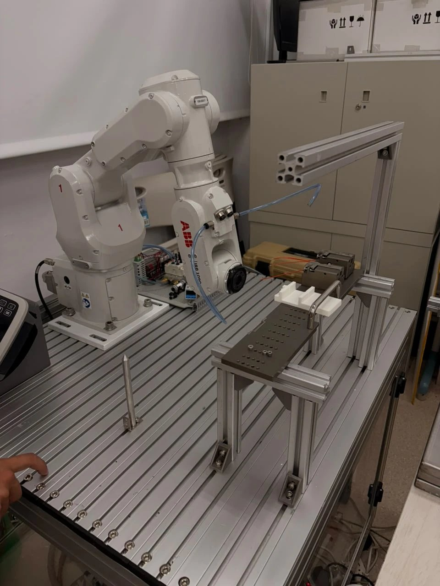
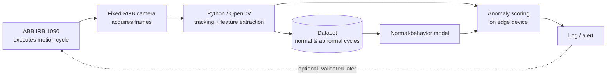

# Industrial Robot Self-Awareness Enhancement with Edge AI

> Capstone project · National Taiwan University of Science and Technology (NTUST / Taiwan Tech) · 2026–2027
> **Status: under development.** This repository is the project's shared workspace: documentation, code, experiment protocols and results.

Industrial robots repeat programmed trajectories, but they usually have no independent way to *see* whether a motion or a part-handling step went wrong. This project investigates whether a **fixed external RGB camera + Edge AI** can learn what a robot's *normal* operating cycle looks like and **detect abnormal cycles** in real time.

The initial motivation is **automated wire manipulation and insertion**, where grasping, alignment and positioning errors affect assembly quality. The method is designed to generalize to other repetitive tasks: pick-and-place, assembly, inspection and quality control.

"Self-awareness" here means **operational monitoring of observable robot behavior**. It does not mean consciousness or full robot state estimation.


*ABB IRB 1090 workcell with the aluminium-profile fixture, cable-support part and camera mounting frame.*

---

## Team

| Member | Role |
|---|---|
| **Esteban Gomez** | RGB computer vision and visual motion analysis |
| **Cristhian Guerreño** | ABB industrial robot control and calibration |
| **Ian Ruiz Diaz** | AI and Edge computing |

**Academic advisor:** Prof. Shu-Hao Liang

---

## How the system works (concept)



1. The robot runs one simple, repeatable cycle.
2. A fixed camera records the cycle.
3. Vision code tracks a visible part of the robot or workpiece and extracts features: position, orientation, speed and timing.
4. Many **normal** cycles are used to learn normal behavior.
5. Each new cycle gets an **anomaly score**. Statistical baselines are compared with ML methods.
6. The detector runs on an **edge device** and reports the cycle status. Automatic correction is an optional future extension.

Details: [System architecture](docs/02_system_architecture.md).

---

## Repository structure

```
.
├── README.md                  ← you are here
├── docs/                      ← project documentation (start here)
│   ├── 01_project_overview.md
│   ├── 02_system_architecture.md
│   ├── 03_robot_calibration.md
│   ├── 04_vision_pipeline.md
│   ├── 05_dataset_and_experiments.md
│   ├── 06_anomaly_detection_and_edge.md
│   ├── 07_validation_metrics.md
│   ├── 08_roadmap_and_status.md
│   ├── meeting-notes/         ← dated notes from team / advisor meetings
│   └── images/
├── robot/rapid/               ← ABB RAPID programs (RobotStudio)
├── vision/
│   ├── cognex/                ← Cognex camera acquisition scripts
│   └── notebooks/             ← exploratory Jupyter notebooks
├── ai/                        ← anomaly-detection models and training code
├── edge/                      ← edge deployment and benchmarking
├── configs/                   ← versioned configuration files (no secrets)
├── experiments/               ← experiment protocols and logs
├── data/                      ← dataset description (raw data is NOT committed)
├── results/                   ← figures, tables and metrics
├── tests/                     ← automated tests
├── requirements.txt
└── CONTRIBUTING.md            ← Git workflow and team conventions
```

---

## Quick start

```bash
git clone https://github.com/cristhianguerreno/Capstone-Project-UPTP-1.git
```

```bash
cd Capstone-Project-UPTP-1
```

```bash
python -m venv .venv && source .venv/bin/activate
```

```bash
pip install -r requirements.txt
```

**Download an image from the Cognex camera.** The PC must be on the lab network. The script asks for the IP address and credentials, which are never stored:

```bash
python vision/cognex/cognex_ftp_capture.py --show
```

**Run the tests.** No camera is needed:

```bash
pytest
```

See [`vision/README.md`](vision/README.md) for all options.

---

## Current status (snapshot: 2026-11-25)

| Area | Status |
|---|---|
| Project definition, team and scope | ✅ Defined |
| ABB IRB 1090 platform and RobotStudio / RAPID | ✅ Available |
| Cognex In-Sight camera discovered and image acquisition over FTP | ✅ Working (sample code in repo) |
| Focus / exposure adjustments | 🟡 Preliminary, qualitative only |
| Robot calibration (TCP, workobject, repeatability) | 🟡 Planned, not yet completed |
| Camera calibration (intrinsics / extrinsics) | ⬜ Not started |
| Fixed camera mount and viewpoint | ⬜ To be decided |
| Tracking and feature extraction | ⬜ Exploratory only |
| Dataset (normal / abnormal cycles) | ⬜ Not collected |
| Anomaly-detection model | ⬜ Not trained |
| Edge hardware | ⬜ Not selected |
| Integrated prototype | 🎯 Target: January 2027 |

Full roadmap and open questions: [Roadmap and status](docs/08_roadmap_and_status.md).

---

## Documentation index

| Document | Content |
|---|---|
| [01 · Project overview](docs/01_project_overview.md) | Problem, scope, objectives, research questions |
| [02 · System architecture](docs/02_system_architecture.md) | Hardware, software, data flow, workcell concept |
| [03 · Robot calibration](docs/03_robot_calibration.md) | ABB calibration plan, coordinate frames, safety |
| [04 · Vision pipeline](docs/04_vision_pipeline.md) | Camera acquisition, calibration, tracking, features |
| [05 · Dataset and experiments](docs/05_dataset_and_experiments.md) | Experimental design, data schema, labeling |
| [06 · Anomaly detection and edge](docs/06_anomaly_detection_and_edge.md) | Models to compare, edge deployment |
| [07 · Validation metrics](docs/07_validation_metrics.md) | How results will be measured and reported |
| [08 · Roadmap and status](docs/08_roadmap_and_status.md) | Milestones, current status, open questions |
| [Meeting notes](docs/meeting-notes/) | Dated records of team decisions |

---

## Safety and data policy

- All robot tests use safe taught points, reduced speeds, verified clearance and lab supervision. **Collisions are never generated as anomaly tests.**
- Vision/AI monitoring is **not** a safety-rated protection system.
- **No credentials, passwords or lab network details** are committed to this repository. Use environment variables or local config files that are listed in `.gitignore`.
- Large raw datasets are stored outside Git. See [`data/README.md`](data/README.md).

---

## License

To be defined by the team and advisor.
