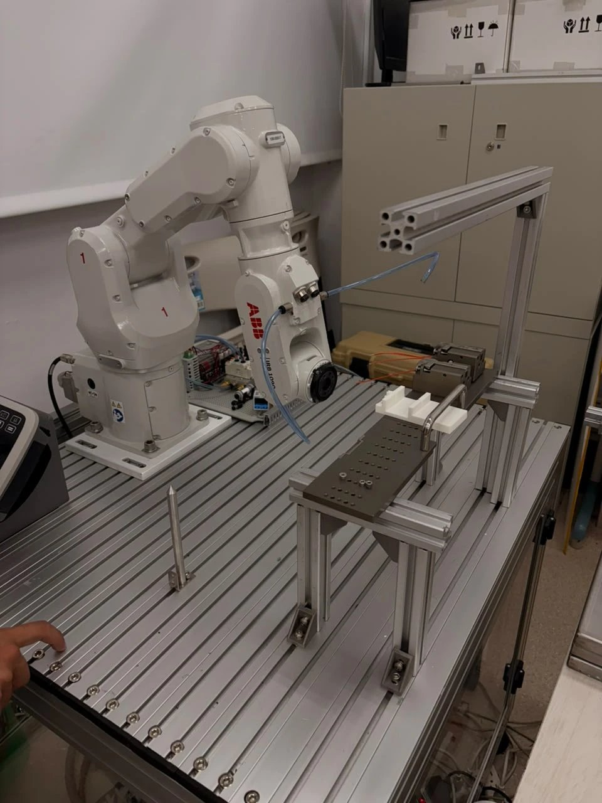
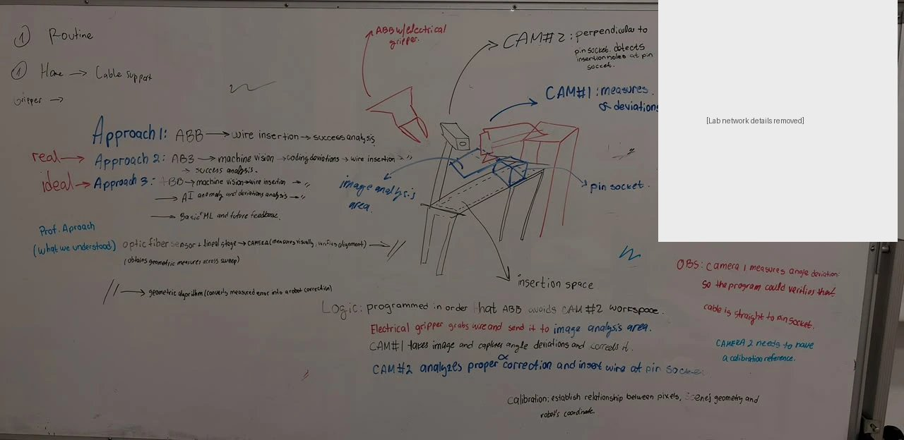
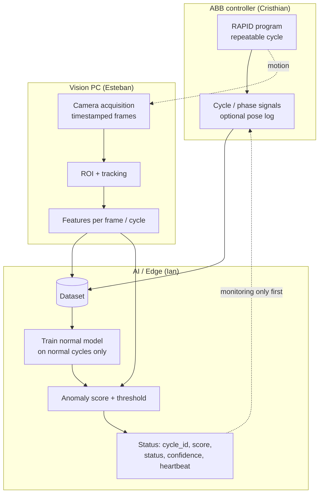

# 02 · System Architecture

## Hardware and software

| Component | Item | Status / notes |
|---|---|---|
| Robot | **ABB IRB 1090** (6-axis) | Available in the lab |
| Robot software | ABB RobotStudio, RAPID | Available |
| Camera | **Cognex In-Sight** industrial camera. Reported model: IS 8100M-363-40 | Discovered in software. Images acquired over FTP. **Check the exact label:** the "M" suffix may mean a monochrome sensor. Frame rate, optics, streaming options and licensing still need checking. |
| Vision software | Python, OpenCV, NumPy, Matplotlib | In use |
| Edge device | To be selected. A Raspberry Pi was discussed earlier. | Not confirmed |
| Optional sensor | KEYENCE FS-N40 fiber-optic sensor, proposed by the advisor | Possible complement for wire presence/alignment. It does not replace visual monitoring. |
| Gripper | Electric gripper. Candidates researched: PGE 8-14, double-V fingers for 1–4 mm cables, 3D-printed vs. CNC fingers. | No final selection |

> If the Cognex camera cannot provide the color stream or video stream the research needs, another suitable RGB camera will be evaluated. The research question stays the same.

## Workcell

The workcell is built on an aluminium-profile table. It has:
- the ABB IRB 1090 on a base plate,
- a raised fixture plate with a white **cable-support** part (the infeed),
- an overhead aluminium frame for mounting cameras,
- a reference pin on the table that can serve as a physical reference.

## Wire-insertion concept (whiteboard session, 2026-11-25)

*Lab network details on the board were removed before publishing.*

The team discussed three levels of ambition:

| Approach | Pipeline | Label on board |
|---|---|---|
| **1** | ABB → wire insertion → success analysis | Baseline |
| **2** | ABB → machine vision → measure deviations → wire insertion → success analysis | **"Real"**: feasible target |
| **3** | ABB → machine vision → wire insertion → AI anomaly and deviation analysis → basic ML and future feedback | **"Ideal"** |

**Proposed sequence (Approach 2/3):**
1. The robot, with an **electric gripper**, picks the wire from the cable support.
2. The robot carries the wire to the **image analysis area**.
3. **CAM #1** captures an image and measures the wire's **angle deviation**, so the program can check that the cable is straight before it reaches the pin socket.
4. **CAM #2** is mounted **perpendicular to the pin socket** and detects the insertion holes. It is used to check the correction and guide insertion at the pin socket.
5. The robot program is ordered so that the ABB **avoids CAM #2's workspace**.

**Calibration requirement:** establish the relationship between **pixels, scene geometry and robot coordinates**. CAM #2 needs a calibration reference.

**Advisor's approach, as the team understood it:** an optic-fiber sensor plus a linear stage obtains geometric measurements across a sweep. A camera visually verifies alignment. A geometric algorithm converts the measured error into a robot correction.

> **Relation to the core research.** The two-camera insertion concept is the **application** scenario. The core deliverable is still monitoring with **one fixed camera** and anomaly detection on a simple repeatable cycle. CAM #2, automatic correction and insertion success analysis are extensions to add after the core works. The two cameras are independent viewpoints, not a synchronized stereo system.

## Data flow

## Integration options to investigate

- ABB socket messaging (a historical `TCPServer` RAPID sample exists; see [`robot/rapid/`](../robot/rapid/README.md)).
- Digital I/O between the controller and the vision PC or edge device.
- Native Cognex / ABB Integrated Vision. The manual *3HAC067707 AM Integrated Vision OmniCore* is available but has not been reviewed yet. Integrated Vision cannot be assumed to run arbitrary Python or ML.
- Still to confirm: RobotWare version, licenses, network configuration and safe-state behavior.

**Rule:** start in **monitoring-only** mode. Any corrective action must be bounded, independently checked, approved, and tested in simulation before physical tests.
