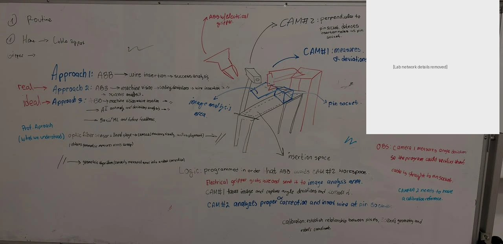

# 2026-11-25 · Lab session: workcell concept and Cognex sample

**Participants:** Cristhian Guerreño, Esteban Gomez, Ian Ruiz Diaz

## Summary
- Reviewed the ABB IRB 1090 workcell and discussed the wire-insertion concept on the whiteboard.
- Shared the first working Cognex sample code, which downloads the current image over FTP. It was added to the repository as `vision/notebooks/cognex_ftp_capture.ipynb` and `vision/cognex/cognex_ftp_capture.py`.
- Consolidated the project context into the documentation in `docs/`.
- Created the shared GitHub repository.

## Whiteboard content

**Routine:** home → cable support → gripper.

**Approaches**
1. ABB → wire insertion → success analysis.
2. *(real)* ABB → machine vision → measure deviations → wire insertion → success analysis.
3. *(ideal)* ABB → machine vision → wire insertion → AI anomaly and deviation analysis → basic ML and future feedback.

**Advisor's approach (as understood):** optic-fiber sensor + linear stage → camera (measures visually, verifies alignment). The fiber sensor obtains geometric measurements across a sweep. A geometric algorithm converts the measured error into a robot correction.

**Cameras**
- **CAM #1** measures deviations. It captures the wire's angle deviation in the image analysis area, so the program can check that the cable is straight before it reaches the pin socket.
- **CAM #2** is perpendicular to the pin socket and detects the insertion holes. It checks the correction and guides insertion. **CAM #2 needs a calibration reference.**

**Logic**
- The program is ordered so that the ABB avoids CAM #2's workspace.
- The electric gripper grabs the wire and takes it to the image analysis area.
- CAM #1 takes an image, captures the angle deviations and corrects them.
- CAM #2 checks the correction, and the robot inserts the wire at the pin socket.

**Calibration:** establish the relationship between pixels, scene geometry and the robot's coordinates.

## Decisions / notes
- The two-camera insertion scenario is the **application**. The core research is still anomaly detection with **one fixed camera** (see [02 · System architecture](../02_system_architecture.md)).
- Lab network details (router, IP addresses, passwords) were written on the board. They were **removed from the published image** and must not be committed.

## Next actions
- [ ] Confirm the exact Cognex model and capabilities (Esteban)
- [ ] Check robot calibration status and define TCP and workobject (Cristhian)
- [ ] Draft the data schema and baseline detector (Ian)
- [ ] Agree on the minimum experiment with Prof. Liang (all)
